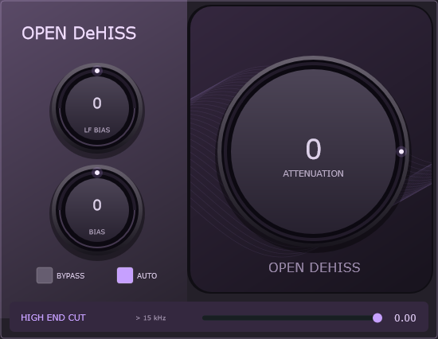

# Open DeHISS

Plugin VST3 Windows x64 para redução de hiss, open source AGPLv3, em desenvolvimento beta.



Interface lilás com três knobs: Atenuação grande à direita, LF Bias e Bias à esquerda, Auto e Bypass embaixo. Com Auto desligado, Bias passa a Threshold. Gráficos próprios; nenhum recurso ou código do CEDAR é distribuído. Atenuação padrão **0 dB**, ajustável até **−40 dB**.

## Uso

Para comparações automáticas com uma referência licenciada, consulte o
[protocolo técnico de concordância espectral](docs/OBJECTIVE-VOICE-9.md).
Esse índice usa tolerância de 1 dB, registros de execução e hashes; não mede
equivalência perceptiva ou porcentagem de algoritmo recuperado. A
[avaliação de escuta pessoal](docs/PERCEPTUAL-V2.md) é um procedimento separado.

Copie a pasta inteira `Open DeHISS.vst3` para `C:\Program Files\Common Files\VST3\`. No FL Studio: Options → Manage plugins → Find installed plugins. Procure Open DeHISS. Comece em 0 dB e desça gradualmente para −6, −12… conforme o ruído. Duplo clique nos knobs restaura o padrão. Auto estima o ruído ao longo do tempo; em modo manual, ajuste Threshold. MIX fica visível acima do dial principal: 0% é sinal seco alinhado e 100% é processado.

Latência reportada no beta 0.4: 4096 amostras a 44,1/48 kHz (92,9/85,3 ms); 8192 a 96 kHz (85,3 ms). A resolução maior separa melhor harmônicos próximos, mas aumenta o atraso para monitoramento ao vivo. O plugin não altera configurações de áudio do Windows. Sem iLok, ativação ou comunicação de rede no código próprio.

## Supressão sob voz — beta 0.4.0

Estimador temporal e espectral corrigido para não aprender imediatamente todo componente sustentado como ruído. Janela Hann com sobreposição de 75% reduz o vazamento de harmônicos para bins vizinhos. A decisão usa energia média acima do piso estimado; não existe uma proteção incondicional baseada apenas em coerência tonal.

Para reduzir sobras durante a voz, aumente **Bias** gradualmente para +6 e, se necessário, +10 dB. Isso aumenta a estimativa de ruído e a supressão também em componentes fracos. Pode retirar detalhes da voz; Atenuação determina o limite máximo, não a redução garantida em cada faixa. Sons misturados no mesmo bin não podem ser perfeitamente separados por esta máscara espectral.

## Beta 0.10.0 — Teste A/B 1

O controle MIX agora aparece na interface, permitindo comparar sinal seco alinhado e processado. Esta revisão de interface mantém o mesmo DSP da candidata hold80 validada: liberação rápida de 40 ms somente após 80 ms contínuos sem evidência densa; nos demais casos, mantém 120 ms. Ataque de 20 ms.

A build local passou três conjuntos CTest e carregamento do VST3 instalado. A candidata DSP foi previamente validada com voz, barítonos e transientes; a matriz histórica permanece em 27/28, com uma divergência no degrau de ruído em −26 dB. Esses resultados não comprovam equivalência perceptiva nem recuperação integral do algoritmo da referência. Consulte [notas da versão](docs/BETA-0.10-AB1.md).

## Beta 0.9.0

A supressão em atenuação funda ganhou profundidade **só acima de 8 kHz e só além de −12 dB**, onde a medição contra a referência licenciada mostrava déficit. O ruído largo estacionário em −26 dB passou de 0,306–0,309 dB abaixo da referência para 0,042–0,045 dB, e a banda 15–24 kHz de +0,70 dB para +0,11 dB. Os 14 casos de −12 dB, os seis tons sustentados e os seis casos de ruído entre harmônicos de barítono saíram **bit-idênticos** ao beta 0.8, por construção do limite de frequência e profundidade. O critério RMS continua 27 de 28 casos; o caso reprovado (salto de ruído em −26 dB) piorou de +1,352 para +1,997 dB de diferença agregada por causa da liberação de supressão da referência nos últimos 250 ms do render, e isso está documentado sem ajuste de tolerância. Latência, interface e controles inalterados. Consulte [mudanças, critérios e limitações](docs/BETA-0.9.md). Não é alegação de equivalência perceptiva ao CEDAR.

## Beta 0.8.0

O detector de subida do ruído reage em 40 ms, mantendo a latência interna máxima de 96 ms. A validação licenciada aprovou 27 de 28 casos ativos no critério RMS (96,43%) e melhorou o erro temporal da transição sem exceder 0,5 dB de perda adicional nos três eventos sintéticos. Consulte [resultados e limitações](docs/BETA-0.8.md).

## Beta 0.7.0

Novo motor independente derivado das equações auditadas, com dois caminhos paralelos para ruído variável e resíduos entre harmônicos. A candidata passou nos 28 casos do critério RMS e nos seis casos de barítono, com atraso interno de até 96 ms. Consulte [mudanças, critérios e limitações](docs/BETA-0.7.md). Não é uma alegação de equivalência perceptiva integral ao CEDAR.

## Beta 0.6.0

Versão e data aparecem na interface. O atraso interno respeita 96 ms nas taxas testadas; há ajustes de calibração do modo Auto. A comparação RMS parcial passou em 26 de 28 casos, sem demonstrar equivalência perceptiva. Consulte [mudanças, evidências e limitações](docs/BETA-0.6.md). O protótipo matemático derivado da auditoria ainda não está ativo no VST3.

## Adaptação a aumentos de ruído — beta 0.5.0

Quando a estimativa de ruído sobe persistentemente em mais de 65% dos bins entre 800 Hz e 12 kHz, o estimador acelera o acompanhamento por uma janela de 0,8 s. O histórico temporal continua rejeitando eventos curtos. Em três taxas de amostragem, um salto de hiss de20 dB recebeu cerca de24 dB de redução após1 s. Ainda há vazamento durante os primeiros aproximadamente0,5 s; não é equivalência ao CEDAR. Latência, interface e controles permanecem como no beta0.4. Consulte [evidências do beta0.5](docs/BETA-0.5.md).

## High End Cut (0.3.0)

Controle independente de **0 a −40 dB**, padrão **0 (desligado)**, dedicado ao hiss acima de **15 kHz**. Use-o mesmo com Atenuação geral em 0 dB. Compartilha o estimador e a regra de supressão do dehiss; não acrescenta outra FFT ou latência. A transição ocorre de 15 a 15,5 kHz, com força completa acima de 15,5 kHz. Com Atenuação geral desligada, os bins até 15 kHz mantêm ganho unitário; pequenas diferenças próximas à borda são inerentes à análise por janelas.

É uma supressão adaptativa de hiss, e não um filtro passa-baixas que apaga todo o áudio acima de 15 kHz: componentes classificados como sinal podem permanecer. Auto/Bias/Threshold também influenciam essa estimativa. Se ambos os controles estiverem ativos, aplica o maior limite de redução por bin, evitando empilhar dois dehiss. Bypass e Mix continuam valendo para todo o processamento.

## Build

Requisitos: Visual Studio 2022 Build Tools com C++, Windows SDK e CMake ≥3.22. Use um checkout curto (por exemplo C:\OpenDeHISS). JUCE 8.0.15 é baixado automaticamente de um commit fixado com hash do ZIP validado. Para build offline, passe `-DJUCE_SOURCE_DIR=C:/caminho/JUCE`.

```powershell
cmake -S . -B build -G "Visual Studio 17 2022" -A x64 -DOPEN_DEHISS_BUILD_HOST_CHECK=ON
cmake --build build --config Release --parallel 2
ctest --test-dir build -C Release -V
```

Saída: `build/OpenDeHISS_artefacts/Release/VST3/Open DeHISS.vst3`. GitHub Actions compila e testa no Windows; o ZIP fica nos artefatos de cada execução bem-sucedida.

## Escopo do beta

DSP próprio: STFT com janela Hann e overlap de 75%, estimativa mediana temporal e quantil espectral com acompanhamento assimétrico, classificação por razão sinal/piso e suavização temporal. Não há equivalência comprovada ao CEDAR. Preservação perceptiva da voz, musical noise, automação sem cliques e desempenho prolongado ainda estão em avaliação. Ruído tonal forte ou sobreposto aos harmônicos pode permanecer.

Testes: transparência 0 dB, latência, overlap-add, bypass, Mix=0, silêncio, NaN/Inf, atenuação manual, redução automática, canais estéreo, persistência de parâmetros, blocos variáveis e renderização da interface. O host de teste separado carrega o VST3 compilado.

Comparação A/B e host de referência: [instruções do benchmark](docs/BENCHMARK.md). A rodada inicial demonstrou diferenças grandes na redução automática e na preservação de tons sustentados; consulte [validação](docs/VALIDATION.md). Os testes de estabilidade do beta não comprovam equivalência da qualidade do processamento.

## Licença

Código próprio AGPL-3.0-or-later (LICENSE.txt). JUCE utilizado sob AGPLv3; suas licenças e avisos de dependências acompanham o código baixado. Não há dependência de licença paga.
